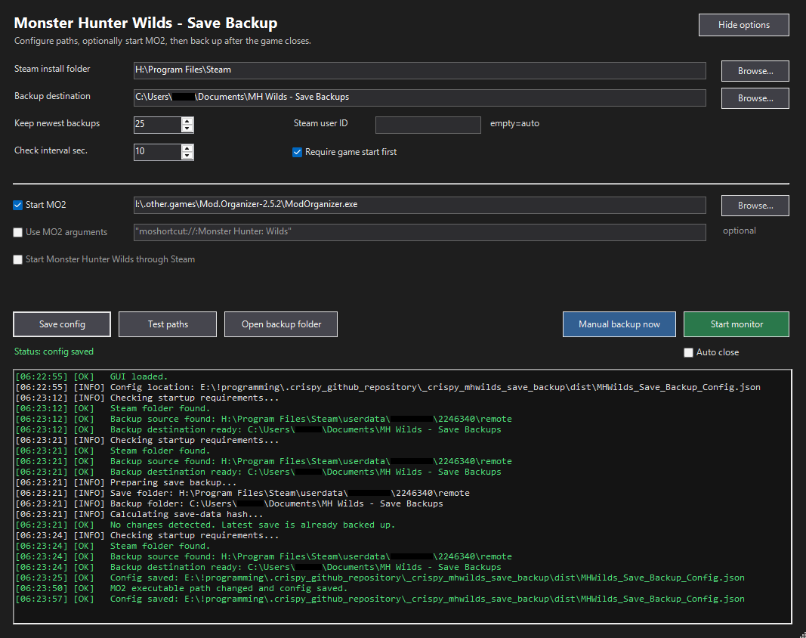

# Monster Hunter Wilds - Save Backup

## Description

A small Windows GUI tool that automatically backs up your **Monster Hunter Wilds** save data after you close the game. It can also launch **Mod Organizer 2** (and optionally the game itself through Steam) for you, so one click starts your whole session and the backup happens when you're done.



## Features

- **Automatic backup on game exit.** Watches for `MonsterHunterWilds` to start and close, then zips your save folder.
- **Only backs up when something changed.** The save folder is hashed (SHA-256 per file, then combined) and compared with the last backup, so you don't pile up identical zips.
- **Running-game check.** A backup is refused while the configured game process is detected as running.
- **Automatic cleanup.** Keep only the newest _N_ backups (set to `0` to keep everything).
- **Optional Mod Organizer 2 launch.** Start `ModOrganizer.exe` with optional arguments (for example a `moshortcut://` link).
- **Optional Steam launch.** Start the game via `steam://rungameid/...`.
- **Steam user auto-detection.** Leave the Steam user ID empty and the newest user folder containing MH Wilds data is used. A warning is logged if several are found.
- **Manual backup** button for when you just want a backup right now.
- **Auto close** option to close the tool after a successful backup check.
- **Hide options** for a compact monitor-only view.
- **Colour-coded log** showing exactly what the tool is doing.
- Settings are saved automatically as JSON next to the script/exe.

## Requirements

- Windows 10 or 11
- Windows PowerShell 5.1 (included with Windows) or PowerShell 7
- Monster Hunter Wilds on Steam
- Optional: [Mod Organizer 2](https://github.com/ModOrganizer2/modorganizer)

## Getting started

### Option A: Run the script

1. Open the included [PowerShell script](src/MHWilds_Save_Backup_GUI.ps1) in `src`.
2. Right-click it and choose **Run with PowerShell**, or run:

   ```powershell
   powershell -NoProfile -ExecutionPolicy Bypass -STA -File .\src\MHWilds_Save_Backup_GUI.ps1
   ```

   If it is started from a non-STA host, the script relaunches itself in STA mode automatically.

### Option B: Use the compiled `.exe`

Run [MHWilds Save Backup GUI.exe](<dist/MHWilds Save Backup GUI.exe>) from `dist`. The compiled GUI uses no PowerShell console. The repository has a [Releases page](https://github.com/SBDG-0/crispy_mhwilds_save_backup/releases); this guide does not assume a published release is available.

### Building the `.exe` yourself

The script is written to be compatible with [PS2EXE](https://github.com/MScholtes/PS2EXE):

```powershell
Install-Module ps2exe -Scope CurrentUser
Invoke-PS2EXE .\src\MHWilds_Save_Backup_GUI.ps1 ".\dist\MHWilds Save Backup GUI.exe" -noConsole -title "MH Wilds Save Backup" -iconFile .\src\MHWilds.ico
```

Run build commands from the repository root, creating `dist` first if needed. The [recorded build command](.resources/ps2exe_cmd.txt) includes additional executable metadata.

Zips are created with the .NET `ZipFile` API instead of `Compress-Archive`, so compiled builds don't depend on the `Microsoft.PowerShell.Archive` module.

## Usage

1. **Steam install folder:** the folder that contains `userdata` (for example `C:\Program Files (x86)\Steam`).
2. **Backup destination:** where the zip files will be stored.
3. _(Optional)_ Tick **Start MO2** and browse to `ModOrganizer.exe`. Tick **Use MO2 arguments** if you want to pass something like `"moshortcut://:Monster Hunter: Wilds"`.
4. _(Optional)_ Tick **Start Monster Hunter Wilds through Steam**.
5. Click **Test paths** to verify everything is found.
6. Click **Start monitor**, then play. When you quit the game, the backup runs automatically.

The button turns into **Stop monitor** while watching; click it to cancel.

### Options

| Option                                   | Default                             | Description                                                                                                    |
| ---------------------------------------- | ----------------------------------- | -------------------------------------------------------------------------------------------------------------- |
| Steam install folder                     | `C:\Program Files (x86)\Steam`      | Folder containing `userdata`.                                                                                  |
| Backup destination                       | `Documents\MH Wilds - Save Backups` | Where backup zips and the hash file are stored.                                                                |
| Keep newest backups                      | `50`                                | Older backups beyond this count are deleted. `0` disables cleanup.                                             |
| Steam user ID                            | _(empty = auto)_                    | Set this if you have multiple Steam accounts on the machine.                                                   |
| Check interval sec.                      | `5`                                 | How often the game process is checked (1-120).                                                                 |
| Require game start first                 | on                                  | Only back up after the game has been seen running. If off, the backup runs as soon as the game isn't detected. |
| Start MO2 / MO2 arguments                | off                                 | Launch Mod Organizer 2 when the monitor starts.                                                                |
| Start Monster Hunter Wilds through Steam | off                                 | Launch the game via Steam when the monitor starts.                                                             |
| Auto close                               | off                                 | Close the tool after the backup check completes.                                                               |

### Buttons

- **Save config:** saves settings immediately (path changes are also auto-saved).
- **Test paths:** checks the Steam folder, save folder, and backup destination.
- **Open backup folder:** opens the destination in Explorer.
- **Manual backup now:** runs a backup check immediately (refused if the game is running).
- **Hide options / Show options:** collapses or expands the settings area.

## What gets backed up

The default `remote` scope backs up the game's Steam save folder:

```
<Steam>\userdata\<SteamUserID>\2246340\remote
```

(`2246340` is the Steam App ID for Monster Hunter Wilds.)

The source also supports `BackupScope = win64_save` for only `remote\win64_save`. The current GUI saves the default `remote` scope; it does not expose a separate scope control.

Backups are named:

```
MH Wilds Save Backup - YYYY-MM-DD_HH-mm-ss.zip
```

A `Last save hash.txt` file in the backup folder tracks the most recent backed-up state. If you want to force a fresh backup, delete this file.

## Restoring a backup

There is no restore button, so restoring is manual:

1. Close the game (and Steam, ideally, to avoid Steam Cloud overwriting things).
2. Extract the zip you want.
3. Copy its contents into `<Steam>\userdata\<SteamUserID>\2246340\remote`, replacing the existing files.

It's a good idea to keep a copy of your current save before overwriting it.

## Configuration file

Settings are stored in `MHWilds_Save_Backup_Config.json`, next to the script or exe. If that location can't be determined, `%APPDATA%\MHWildsSaveBackup` is used instead. The config location is printed in the log when the app starts.

## Troubleshooting

- **"Steam userdata folder not found":** point _Steam install folder_ at the folder that actually contains `userdata`, not at `steamapps`.
- **"No Monster Hunter Wilds save folder found":** launch the game at least once so the save folder exists, or enter your Steam user ID manually.
- **Wrong Steam account picked up:** enter your Steam user ID (the numeric folder name under `userdata`).
- **Backup cancelled, game still running:** this is intentional. Close the game fully and use **Manual backup now**.
- **Script won't run:** use the `-ExecutionPolicy Bypass` command above, or use the compiled `.exe`.

## Disclaimer

This is an unofficial community tool and is not affiliated with Capcom or Valve. It reads the save source, writes ZIPs and configuration/hash files, and can delete old backups according to the retention setting. Use it at your own risk. Keep backups of important data.

## License

The recorded PS2EXE command contains the attribution `(CC0) SavageBulldogOG`. A standalone license file is not included in this checkout; this README introduces no additional license grant.

---

made with ❤️ by SavageBulldogOG
